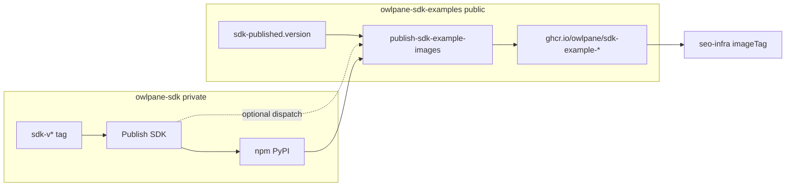

# owlpane-sdk-examples architecture

Public companion to the **private** [owlpane-sdk](https://github.com/OwlPane/owlpane-sdk) monorepo.

## What lives here

| Area | Purpose |
|------|---------|
| **`apps/*`** | One runnable sample per runtime (Node, Go, Python, …) |
| **`docker/apps/*.Dockerfile`** | Production-style images for Kubernetes dogfood |
| **`sdk-published.version`** | Semver pin for **published** npm/PyPI (not git checkout of SDK) |
| **`dogfood.manifest.json`** | Console project names ↔ app ids (onboarding script) |
| **`.github/workflows/publish-sdk-example-images.yml`** | Matrix build → **GHCR** `sdk-example-*` |

## What does **not** live here

- SDK source (`packages/node`, codegen, contract schema) — **owlpane-sdk** only.
- npm/PyPI publish — **Publish SDK** on `sdk-v*` tags in owlpane-sdk.

## CI/CD flow

## Local development

1. Copy `.env.local.example` → `.env`.
2. `./scripts/onboard-dogfood.sh --write-env` (needs API + console).
3. `./run-dogfood.sh` — installs **`@owlpane/node@<sdk-published.version>`** from npm unless you override `OWLPANE_SDK_SOURCE`.

After an SDK release, run **`./scripts/sync-pinned-sdk-version.sh`** whenever **`sdk-published.version`** changes.
